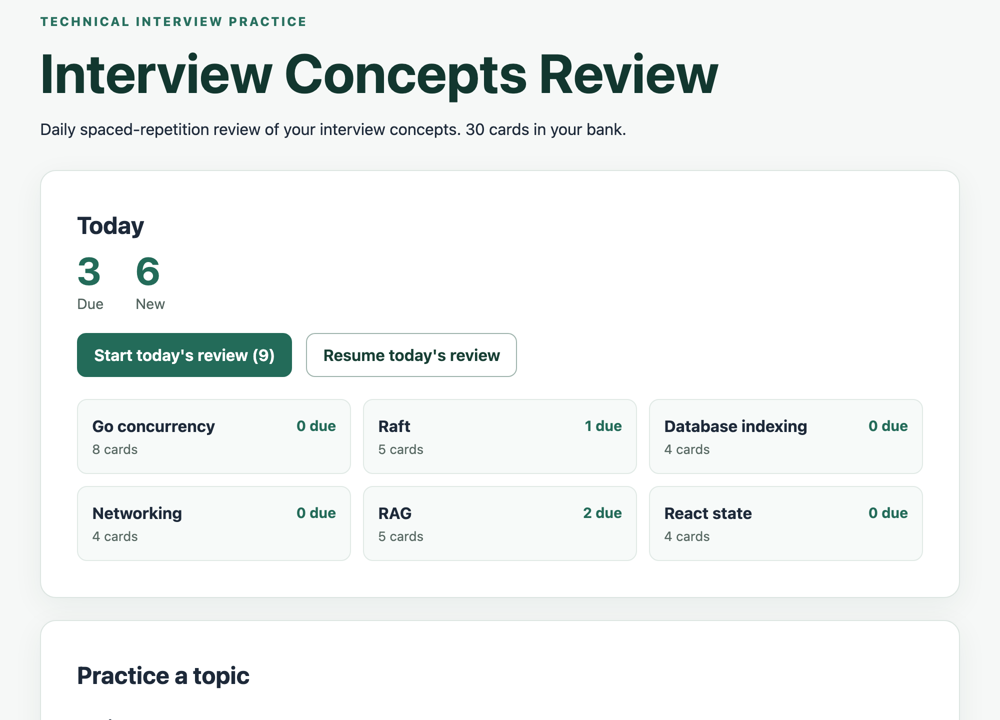

# Interview Concepts Review

**[Try it live → selma0817.github.io/interview-review](https://selma0817.github.io/interview-review/)**

A spaced-repetition refresher for technical interview concepts, generated from my Obsidian notes in [cs-knowledge-base](https://github.com/selma0817/cs-knowledge-base).

<p>
  
  
</p>

A local-first React/Vite app. It loads a static card bank, supports all four card types, and schedules reviews with [FSRS](https://github.com/open-spaced-repetition/ts-fsrs) (the algorithm Anki uses) entirely in this browser. There is no backend or account sync. The design is in [`learning-loop-v2-spec.md`](learning-loop-v2-spec.md).

- **Today** shows the cards due today plus up to 10 new cards a day. **Start today's review** runs due cards first (earliest due first), then new ones.
- **Rating:** after showing a solution, rate the card **Again / Hard / Good / Easy**; each button shows when the card comes back. A wrong multiple-choice answer counts as **Again** automatically; a right one asks for Hard, Good or Easy.
- **Learning steps:** a card in its short learning steps (1 or 10 minutes) comes back at the end of the same session.
- **Practice a topic** picks cards by topic and type regardless of schedule, weakest recall first. Those ratings count normally; FSRS adjusts for reviewing early.

## Local development

Use Node 22 (see `.nvmrc`) and npm:

```bash
nvm use
npm ci
npm run dev
```

Vite prints the development URL, normally `http://localhost:5173/interview-review/`. The repository-prefix path is intentional and matches GitHub Pages.

Run all local checks:

```bash
npm run typecheck
npm run validate:bank
npm test
npm run build
npm run test:e2e
```

Inspect the production build with:

```bash
npm run build
npm run preview
```

Then open `http://localhost:4173/interview-review/`. Playwright starts its own preview server, tests Chromium at desktop and 375px-class mobile size, and expects Chromium installed (`npx playwright install chromium` if needed).

## Question bank

The runtime bank is `public/questions.json`. Replace that file with a complete bank conforming to schema version `1.0.0`, then run `npm run validate:bank`. The validator rejects the entire malformed bank and the app shows a retryable error; it does not silently omit questions. Keep learner data out of this file. Progress is keyed by question ID and version, so increment a question's version when its learning content changes.

The original supplied `questions.json` remains at the repository root for provenance. At implementation time it was copied byte-for-byte to `public/questions.json`.

## Base path

The default production base is `/interview-review/`, matching the `selma0817/interview-review` repository. For a renamed repository, build with the new leading/trailing-slash path:

```bash
VITE_BASE_PATH=/new-repository-name/ npm run build
```

For a custom domain or root deployment use `VITE_BASE_PATH=/`. Assets and the bank request both use Vite's configured base.

## GitHub Pages deployment

Live site: https://selma0817.github.io/interview-review/ (repository `selma0817/interview-review`).

Nothing is published automatically by this repository. After local review:

1. Create the intended GitHub repository and push this project to its `main` branch.
2. In **Settings → Pages**, choose **GitHub Actions** as the source.
3. Open **Actions → Deploy → Run workflow**, select `main`, and run it.
4. Wait for verification and deployment, then open the URL shown by the `github-pages` environment/workflow output.

The CI workflow runs on pull requests and pushes to `main`. Deployment is separately manual, restricted to `main`, and uses GitHub's Pages/OIDC permissions—no PAT or API key. To opt into push-to-main deployment later, add `push: branches: [main]` under the deploy workflow's `on` block after review.

## Browser data and limitations

Progress uses only `interview-review:fsrs:v1` in localStorage: each card's FSRS state (keyed by `id@version`), the complete review log, new cards introduced per day, filter settings, and the current session. The log is never trimmed, so FSRS parameters can be tuned to your history later, or replayed into a newer FSRS model. The v1 key `cs-review:progress:v1` is removed on first load. Reset removes only the v2 key.

Scheduling uses `ts-fsrs` 5.4.2 (FSRS-6) with 90% desired retention, a 180-day maximum interval and interval fuzz. Bumping a card's `version` gives it a fresh schedule. Data does not sync between browsers or devices; there is no export/import, multi-tab merge, automatic free-text grading, or secure exam mode. Answers in a static deployment are public assets.
