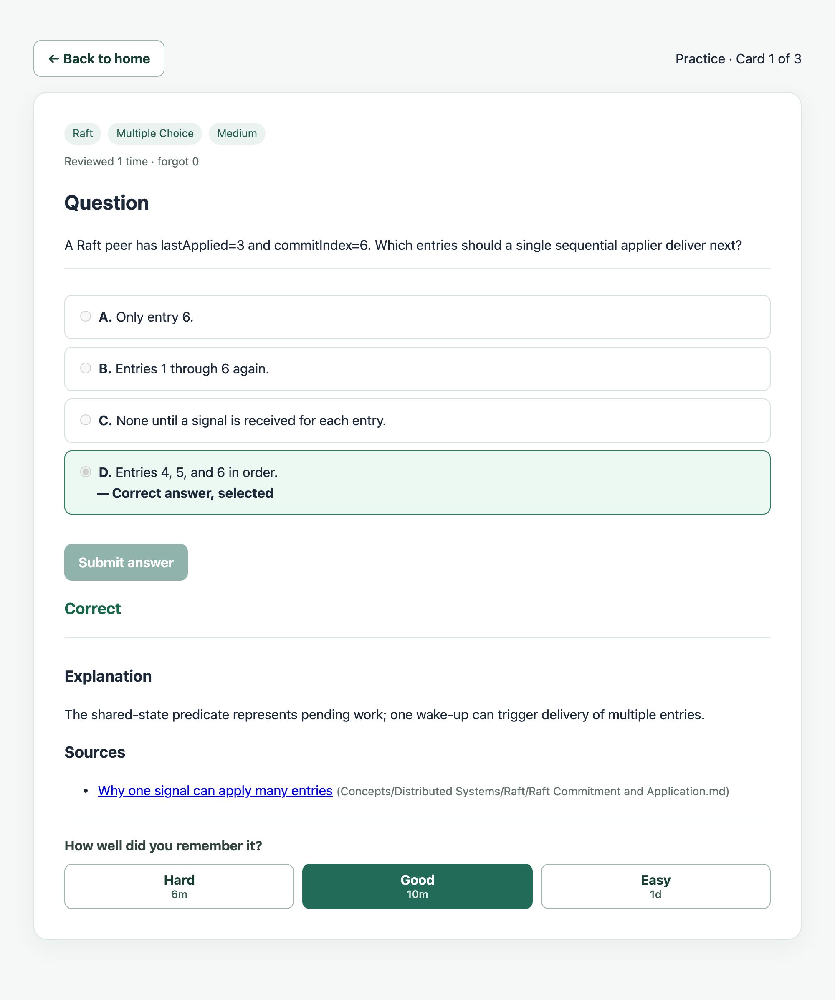

# Interview Concepts Review

**[Try it live → selma0817.github.io/interview-review](https://selma0817.github.io/interview-review/)**

A spaced-repetition refresher for technical interview concepts, generated from my Obsidian notes in [cs-knowledge-base](https://github.com/selma0817/cs-knowledge-base).

<p>
  
  
</p>

A local-first React/Vite app. It loads a static card bank, supports all four card types, and schedules reviews with [FSRS](https://github.com/open-spaced-repetition/ts-fsrs) (the algorithm Anki uses) entirely in this browser. There is no backend or account sync. The design is in [`learning-loop-v2-spec.md`](learning-loop-v2-spec.md).

- **Today** shows the cards due today plus up to 10 new cards a day. **Start today's review** runs due cards first (earliest due first), then new ones.
- **Rating:** after showing a solution, rate the card **Again / Hard / Good / Easy**; each button shows when the card comes back. A wrong multiple-choice answer counts as **Again** automatically; a right one asks for Hard, Good or Easy.
- **Learning steps:** a card in its short learning steps (1 or 10 minutes) comes back at the end of the same session.
- **Practice a topic** picks cards by topic and type regardless of schedule, weakest recall first. Those ratings count normally; FSRS adjusts for reviewing early.

## Local development

Use Node 22 (see `.nvmrc`) and npm:

```bash
nvm use
npm ci
npm run dev
```

Vite prints the development URL, normally `http://localhost:5173/interview-review/`. The repository-prefix path is intentional and matches GitHub Pages.

Run all local checks before pushing:

```bash
npm run check
```

`check` runs the same checks as CI, in the same order as `.github/workflows/ci.yaml`: typecheck, `bank:validate`, unit tests, build, then e2e on Chromium. It stops at the first failure. If you add a check to one of them, add it to the other too. `npm run test:e2e` on its own also runs the mobile project.

Inspect the production build with:

```bash
npm run build
npm run preview
```

Then open `http://localhost:4173/interview-review/`. Playwright starts its own preview server, tests Chromium at desktop and 375px-class mobile size, and expects Chromium installed (`npx playwright install chromium` if needed).

## Question bank

Cards live in **`bank/<topic>.json`**, one file per topic, as `{"topic": "...", "questions": [...]}`. A card lives in the file of its first topic (schema `2.0.0`, defined in `src/lib/questionBank.ts`). `public/questions.json` is **generated** by `npm run bank:build` (part of `npm run build` and `npm run dev`) and is not committed. Edit the bank through the scripts, not by hand:

| Command | What it does |
|---|---|
| `npm run bank:validate` | Checks every topic file: schema, unique IDs across files, no retired IDs, topics all listed in `bank/topics.json`, multiple-choice answers among their options, stamped sources. CI runs it |
| `npm run bank:build` | Validates, then writes `public/questions.json` |
| `npm run bank:add -- drafts.json [--vault ../knowledge_base] [--dry-run]` | Adds draft cards (written by the distill skill, without `id` or source hashes). Assigns each a fresh ID and copies its topics from the cited notes' `topic/` tags; checks that each cited heading exists in a committed, pushed vault note; stamps `blob_sha` and a URL pinned to that commit; appends to the topic file. Doesn't commit |
| `npm run bank:retopic -- [--vault ../knowledge_base] [--dry-run]` | Re-copies every card's topics from the cited notes' current `topic/` tags and refreshes `bank/topics.json`. Run it after retagging notes or renaming a topic in `Topics.md`. Card content and IDs stay, so review progress is untouched |
| `npm run bank:remove -- <id> [<id>…]` | Removes cards and records their IDs in `bank/retired-ids.txt` |

- **IDs are never reused.** Progress is keyed by `id@version`, so a reused ID would hand a new card a deleted card's review history. That's why `bank:add` picks IDs (`<topic>-<6 random characters>`) and skips anything in `retired-ids.txt`.
- **Topics come from the vault, not the LLM.** The vault's `Topics.md` defines the allowed `topic/` tags (concept families like `consensus` or `rl-fine-tuning`, plus `go`, `python`, `java`, `typescript`). Each note carries 1–3 of them in its frontmatter. A card's `topics` are the `topic/` tags of the notes it cites, so a card citing notes on transactions and concurrency shows under both. `bank:add` refuses a cited note without `topic/` tags, or with a tag `Topics.md` doesn't define. `bank/topics.json` is the bank's copy of that list (with areas and descriptions), so CI can check card topics without the vault.
- **Bump `version`** only when a card's meaning changes. That gives it a fresh review schedule.
- **Card fields:** `created`, `provenance` (the session moment it came from) and `checks` (`grounded`, `blind_answer`, `code_run`: `pass`, `n/a`, or `not_run` for cards migrated from v1). Unknown fields are rejected.

The 30 v1 questions were migrated unchanged into `bank/` on 2026-11-18, with `checks` set to `not_run` until they go through the three checks. The original v1 file remains at the repository root (`questions.json`) for provenance.

## Base path

The default production base is `/interview-review/`, matching the `selma0817/interview-review` repository. For a renamed repository, build with the new leading/trailing-slash path:

```bash
VITE_BASE_PATH=/new-repository-name/ npm run build
```

For a custom domain or root deployment use `VITE_BASE_PATH=/`. Assets and the bank request both use Vite's configured base.

## GitHub Pages deployment

Live site: https://selma0817.github.io/interview-review/ (repository `selma0817/interview-review`).

Every merge to `main` deploys automatically, but only after the full checks pass:

```
PR → CI (ci.yaml: typecheck, bank, unit tests, build, e2e) → merge
   → Deploy (deploy.yaml): ci / checks → pack the tested dist/ → deploy-pages → live
```

- **Pull requests** run `.github/workflows/ci.yaml` only. Its last step, which packs `dist/` as the Pages artifact, is skipped on PRs.
- **Deploy** (`.github/workflows/deploy.yaml`) runs on every push to `main` (in practice, every merge). It calls `ci.yaml` as a reusable workflow, then publishes the exact `dist/` that passed e2e. The deploy job never rebuilds.
- **`main` is protected by a ruleset:** changes must arrive through a pull request, the `checks` status check (from GitHub Actions) must pass, and the branch must be up to date. Direct pushes, force pushes and deleting `main` are rejected, with no bypass, even for admins.
- **Manual re-deploy:** **Actions → Deploy → Run workflow** on `main`, or `gh workflow run deploy.yaml --ref main`. Running it from any other branch runs CI but never deploys, because of the deploy job's `if: github.ref == 'refs/heads/main'` guard and the `github-pages` environment's `main`-only branch policy.

Pages is set to deploy from **GitHub Actions** and uses Pages/OIDC permissions, so no PAT or API key is stored.

## Browser data and limitations

Progress uses only `interview-review:fsrs:v1` in localStorage: each card's FSRS state (keyed by `id@version`), the complete review log, new cards introduced per day, filter settings, and the current session. The log is never trimmed, so FSRS parameters can be tuned to your history later, or replayed into a newer FSRS model. The v1 key `cs-review:progress:v1` is removed on first load. Reset removes only the v2 key.

Scheduling uses `ts-fsrs` 5.4.2 (FSRS-6) with 90% desired retention, a 180-day maximum interval and interval fuzz. Bumping a card's `version` gives it a fresh schedule. Data does not sync between browsers or devices; there is no export/import, multi-tab merge, automatic free-text grading, or secure exam mode. Answers in a static deployment are public assets.
